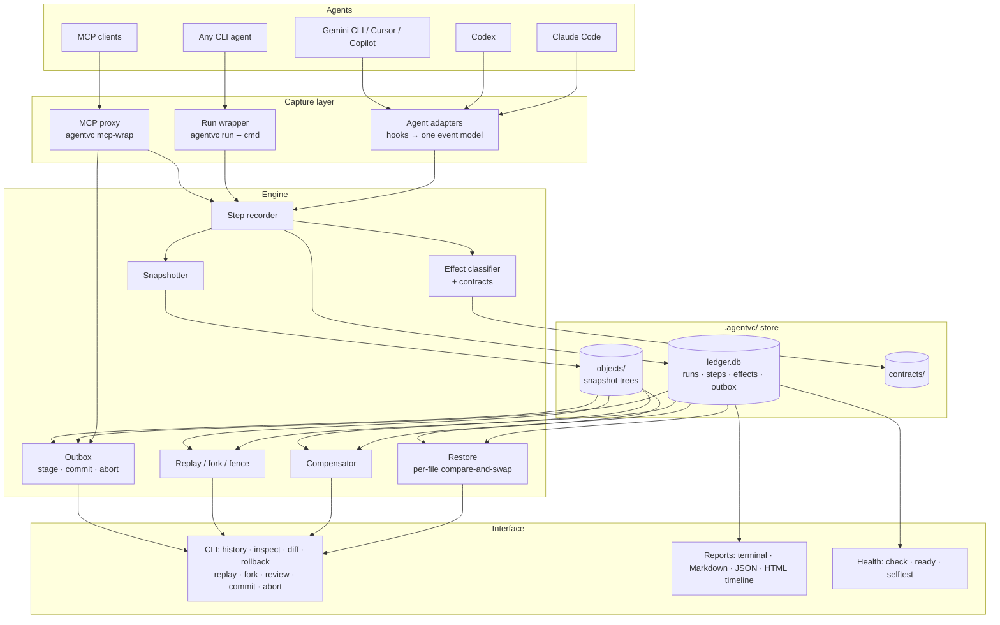
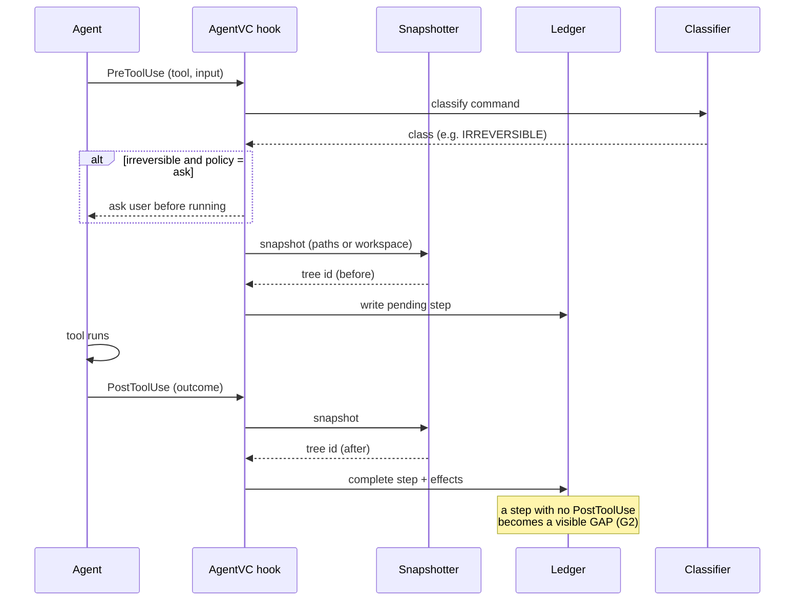
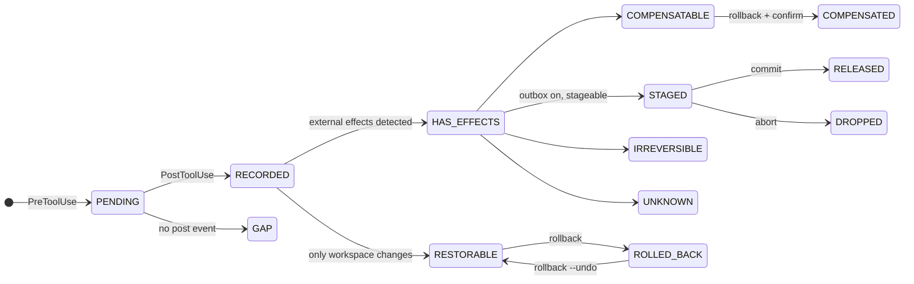
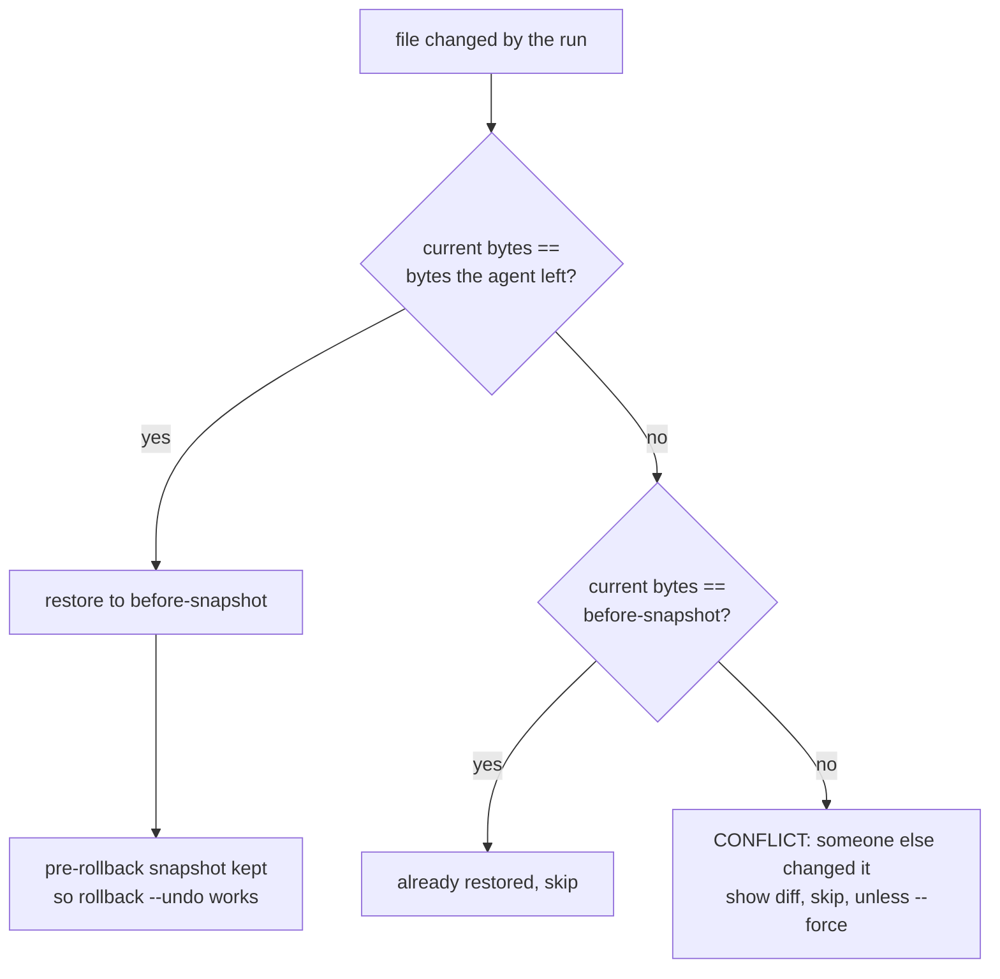
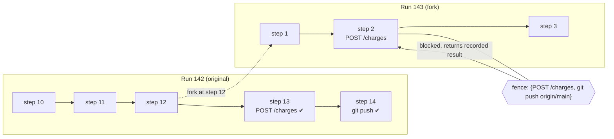
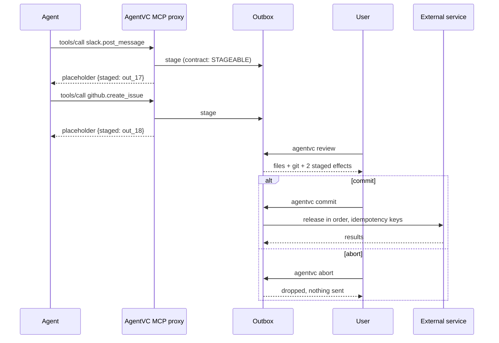
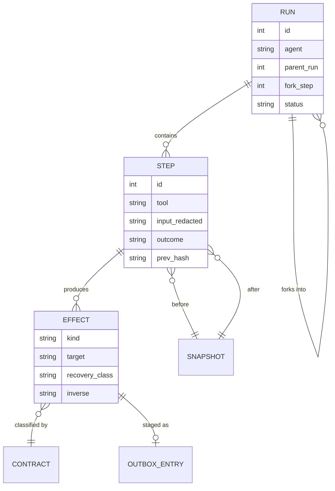
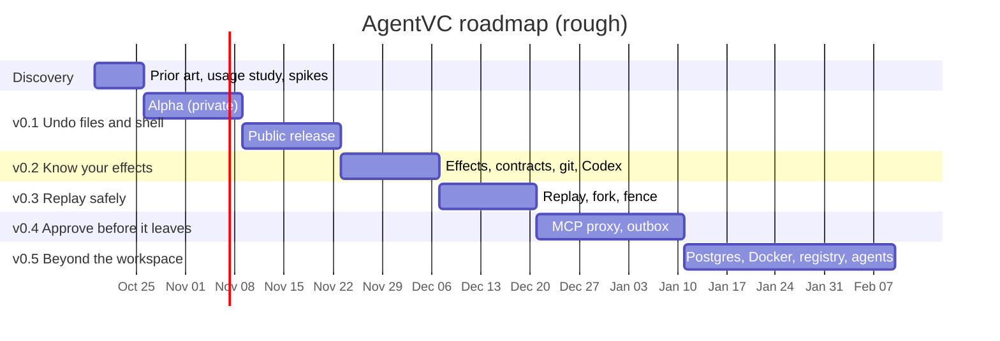
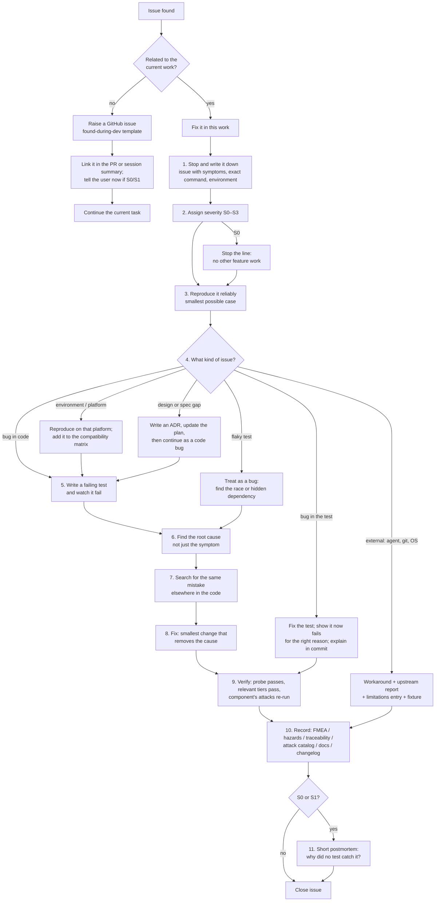

# AgentVC Plan

_v0.4 · 2026-10-17 · Diagrams are Mermaid; they render on GitHub and in VS Code's Markdown preview (all verified with mermaid-cli 11.4.2). Changes are listed in the [plan changelog](#plan-changelog) at the end._

---

## 0. Plan review (v0.3)

A senior-engineering review of v0.2 found these gaps. Each is now addressed where noted.

| # | Gap | Risk if ignored | Fixed in |
|---|---|---|---|
| 1 | Hook process model undecided (a cold Python start per hook may exceed the 50 ms budget on Windows) | Too slow to leave on (G7) | §7.1 spike S1 |
| 2 | No rule for when AgentVC's own hook fails or times out | Agent blocked, or actions silently unrecorded | §7.1 decision D2, §13 |
| 3 | Git alternates: snapshots borrowing objects from the user's repo break if the user runs `git gc` | **Data loss in AgentVC's own history** | §7.1 decision D3, FMEA |
| 4 | Ignored files (`.env`, local configs) excluded from snapshots | The most painful deletions can't be undone | §7.1 decision D4 |
| 5 | G1 vs. `--force`, G6 vs. outbox release: guarantees contradicted features | Unclear promises | §2 wording |
| 6 | No schema version in the ledger from day one | Painful migrations later | §7.1 decision D5 |
| 7 | Hooks don't pin a Python interpreter | Breaks inside projects with their own virtualenv | §7.1 decision D6 |
| 8 | **No procedure for issues found while coding or testing** | Bugs patched over, tests weakened, findings lost | **§13** |
| 9 | No feature definition of done or workflow | Inconsistent quality | §13.1 |
| 10 | v0.1 overloaded; all test gates required from day one | Slips, burnout, or gates quietly ignored | §8 split into alpha + public; §16.3 gate ramp |
| 11 | No way to diagnose problems on users' machines (and no telemetry by design) | Field bugs can't be reproduced | §6 debug log + diagnostics bundle |
| 12 | No success metrics, feedback loop, support policy, release checklist, or incident plan for a released data-loss bug | No way to know if it works for users; slow response to the worst bug | §11, §13.6, §13.7 |

---

## 1. Vision

**Problem.** Coding agents (Claude Code, Codex, Gemini CLI, Cursor, OpenHands…) now run shell commands, install packages, push to git, call APIs and touch databases. Their built-in undo covers only edits made through their own file tools. A `rm -rf` run through the shell, a `git push`, a migration or a sent message can't be taken back, and often the user can't even see the full list of what happened.

**AgentVC** is version control for agent execution. It records every action an agent takes, snapshots the workspace around it, and lets you **see**, **diff**, **roll back**, **replay** and **approve** what the agent did, honestly reporting anything it can't undo.

**Who it's for**
1. Developers running coding agents locally who want a safety net that works across agents.
2. Teams giving agents real credentials who need to know and control what leaves the machine.
3. Agent builders who want a reusable undo/replay layer.

**Non-goals:** not an agent, framework, gateway, dashboard or cloud service. Local-first, no model calls.

---

## 2. Guarantees

| ID | Guarantee |
|---|---|
| **G1** | **Never destroy user work.** A rollback only rewrites a file if it still contains exactly what the agent left; anything else is a conflict, shown and skipped. Every rollback, including one the user explicitly forces with `--force`, first saves the current state, so it can be undone. |
| **G2** | **Nothing silent.** Every agent action becomes a recorded step, or a visible gap. |
| **G3** | **Honest accounting.** Every run report lists restored / compensated / staged / **could not undo, and why**. |
| **G4** | **Never repeat the world.** Replay and fork never re-execute an external effect that already happened, unless explicitly allowed. |
| **G5** | **Nothing leaves early** (outbox on). Staged effects are released only on commit, exactly once. |
| **G6** | **Local and private.** AgentVC never sends its own data anywhere: no telemetry, no cloud. The only outbound traffic it creates is (a) the agent's own calls that it forwards unchanged when acting as an MCP proxy, and (b) staged effects the user explicitly approved (outbox `commit`). Secrets are scrubbed before writing. |
| **G7** | **Cheap enough to leave on.** Overhead stays within the budgets in §10. |
| **G8** | **Can't be silently switched off.** If the agent edits AgentVC's hooks or config, deletes its history, or bypasses recording, the user is told. |

---

## 3. Core concepts

| Concept | Meaning |
|---|---|
| **Run** | One agent session. Runs form a tree: a fork has a parent. |
| **Turn** | All steps caused by one user prompt. The most natural unit to undo ("undo what it did for that request"). |
| **Step** | One agent action (tool call, shell command, edit, MCP call) with input, outcome, timing and before/after snapshots. |
| **Snapshot** | Exact workspace content at a point in time, stored as a git tree in AgentVC's own object store. |
| **Effect** | Something a step did outside the workspace (push, install, DB change, HTTP call, message). |
| **Recovery class** | `NONE-NEEDED` · `RESTORABLE` · `COMPENSATABLE` · `STAGEABLE` · `IRREVERSIBLE` · `UNKNOWN` |
| **Contract** | YAML describing one kind of effect: class, detection, undo/compensation, idempotency, outcome check. |
| **Fence** | In a fork, effects the parent already performed; matching actions are blocked. |
| **Outbox** | Where stageable effects wait for `commit` or `abort`. |

---

## 4. Diagrams

### 4.1 System architecture



### 4.2 What happens on one tool call



### 4.3 Step lifecycle



### 4.4 Rollback decision for each file (G1)



### 4.5 Fork and fence (G4)



### 4.6 Outbox (G5)



### 4.7 Data model



### 4.8 Roadmap timeline



---

## 5. Visual tools AgentVC ships

| Tool | What the user sees | Version |
|---|---|---|
| **`agentvc history --tree`** | Terminal tree of runs and forks, with status and step counts | v0.1 (flat) → v0.3 (tree) |
| **`agentvc inspect <run>`** | Terminal timeline: step, tool, duration, files changed, effects, recovery class, gaps | v0.1 |
| **`agentvc report <run> --html`** | **One self-contained offline HTML file**: interactive step timeline, per-step diff viewer, effects table coloured by recovery class, run tree, "could not undo" panel | v0.2 |
| **`agentvc graph <run> --format mermaid\|dot`** | The run as a graph (steps → effects → snapshots), to paste into issues or docs | v0.3 |
| **Live architecture page** (GitHub Pages) | Interactive map of AgentVC with five views (§5.1) | v0.1 (basic) → grows |

### 5.1 The live architecture page

A single static page in `architecture/`, published on GitHub Pages and linked from the README badge, so anyone can see how AgentVC fits together.

| View | Shows |
|---|---|
| **Overview** | Components grouped by layer (diagram 4.1); click a node for its description, source path, docs and related ADRs |
| **Data flow** | Hook event → step → snapshot → ledger → reports (diagram 4.2), step by step |
| **Lifecycle** | Run / step / effect states (diagram 4.3) |
| **Code map** | Modules and imports, **generated from the code** |
| **Roadmap** | Cards for unfinished work: goal, acceptance criteria, a good first contribution, links. Each is labelled *planned*, *in progress*, *idea* or *conditional (with its trigger)*, kept separate from what's shipped |

### 5.2 How the architecture is made

**Files**

```
architecture/
├── graph.json        single source of truth (hand-maintained parts)
├── codemap.json      generated from imports (never hand-edited)
├── index.html        offline renderer, no external resources
└── README.md         the update rule (§5.3) and how to run the checks
scripts/
├── arch_check.py     validates graph.json against the code and the page
├── arch_codemap.py   regenerates codemap.json from the source
└── arch_export.py    writes Mermaid diagrams for the README/docs from graph.json
```

**`graph.json` shape**

```json
{
  "meta":   { "updated": "2026-10-20", "version": "0.1.0",
              "changelog": ["2026-10-20  ledger + snapshotter added"] },
  "layers": [ { "id": "capture", "label": "Capture layer" }, "..." ],
  "nodes":  [ { "id": "snapshotter", "label": "Snapshotter", "sub": "git trees per step",
                "layer": "engine", "path": "agentvc/snapshot.py",
                "status": "shipped", "desc": "...", "adr": ["0002"] } ],
  "edges":  [ { "from": "recorder", "to": "snapshotter", "kind": "calls" } ],
  "views":  { "dataflow": ["..."], "lifecycle": ["..."] },
  "roadmap":[ { "id": "outbox", "title": "MCP outbox", "status": "planned",
                "goal": "...", "acceptance": ["..."], "first_contribution": "...",
                "links": ["docs/..."] } ]
}
```

**Built in this order**
1. **Discovery:** turn diagrams 4.1–4.3 into the first `graph.json` (everything `status: planned`); page skeleton renders Overview; `arch_check.py` validates structure.
2. **v0.1:** nodes flip to `shipped` as modules land; Data flow and Lifecycle views; checks run in CI; Pages published.
3. **v0.2:** `arch_codemap.py` generates the Code map; `arch_check.py` compares declared edges with real imports.
4. **v0.3:** Roadmap view with cards for v0.4+ work and contributor-sized items (new agent adapters, contracts, Postgres, Docker).
5. **Ongoing:** updated with every architecture change (§5.3).

### 5.3 How the architecture stays up to date

**The rule:** any change to AgentVC's architecture, data flow or workflow updates `architecture/` **in the same pull request**. A stale node is worse than a missing one, because people trust it.

**Counts as an architecture change**
- a new module under `agentvc/` that another module imports, or a removed one
- a new or removed agent adapter, hook event, or change to which tools an event covers (`wiring.py`)
- a new table or column in `ledger.db`, or a new file under `.agentvc/`
- a new recovery class, effect adapter (git, Postgres, Docker…) or contract category
- a new external dependency in the data path (a binary, an MCP server, a database)
- a new CLI command that adds a flow (e.g. `fork`, `commit`)
- a new stage in the evaluation pipeline

**Doesn't need an update:** bug fixes, docs and comments, new tests, refactors that don't change who-imports-whom, new contract YAML files within an existing category.

**Update steps**
1. Edit `graph.json`: add, remove or relabel nodes and edges; keep `id`s stable; keep `sub` short (≤ 42 characters, so boxes don't overlap); put detail in `desc`.
2. Update the affected view (`dataflow`, `lifecycle`).
3. If planned work was **built**: flip its nodes to `shipped` and remove or shrink its roadmap card. Any unmet acceptance criterion stays as a smaller card.
4. Bump `meta.updated`, and prepend one line to `meta.changelog`.
5. Run `python scripts/arch_codemap.py && python scripts/arch_export.py && python scripts/arch_check.py --render`.
6. Commit the architecture change together with the code change.

**Enforcement, so it doesn't depend on memory**

| Check | Catches | Where it runs |
|---|---|---|
| Every `.py` in `agentvc/`, `eval/`, `scripts/` has a node | A new module nobody drew | CI, pre-commit |
| Every node's `path` exists; no dangling edges; unique ids; `sub` length | Deleted or renamed code still on the map | CI, pre-commit |
| Declared edges vs. real imports (from `codemap.json`) | The map claims a connection the code doesn't have, or misses one | CI |
| Docs and README mention no file paths that no longer exist | Outdated references in documentation | CI |
| README Mermaid blocks match `arch_export.py` output | README diagrams drifting from the page | CI |
| Shipped nodes never sit in the Roadmap view, and roadmap cards have all fields | Planned work shown as done, or half-written cards | CI |
| **Render check** (Playwright): every view draws, cards open, filters and narrow layout work | A page that passes every data check but draws nothing (e.g. one bad character in the script) | CI |
| **Only new drift fails**: drift introduced by this PR fails; existing drift is counted and reported | Keeps the check strict without drowning the first run in old findings | CI |

**Convenience extras**
- `make arch` runs all three scripts.
- The PR template has an "architecture updated / not needed because …" line.
- For your own agent sessions on the AgentVC repo, a project hook (`.claude/settings.json`, Stop event) runs `arch_check.py --changed` and prints any module this session added without a node, so the agent fixes it before finishing.
- Release notes include the `meta.changelog` lines since the previous release.
- The render check is trusted only after it has been **seen to fail once**: deliberately break the page, confirm the check fails, restore it, confirm it passes.

---

## 6. Built-in conveniences

Small things that save hours, each designed for AgentVC. Several are patterns proven in other agent tooling, rewritten here for AgentVC's own needs.

### 6.1 For users

| Convenience | What it does | Why it helps | Version |
|---|---|---|---|
| **`agentvc install --agent X`** | Adds AgentVC's hooks to the agent's config, **keeping existing hooks**; entries are marked as AgentVC-owned so `uninstall` removes exactly those | Setup in one command; safe to install next to other tools | v0.1 |
| **`agentvc check`** | Sends a realistic fake tool call through the real hook path and confirms a step + snapshot come back | Catches "installed but silently not recording" | v0.1 |
| **Blind-spot log** `.agentvc/blindspots.jsonl` | Every hook payload AgentVC couldn't parse is saved | When an agent update renames a field, it's a visible symptom instead of silent failure | v0.1 |
| **Session banner** | At session start: "AgentVC recording run #57 · 3 paths unprotected (over size budget)" | The user knows it's on, and what isn't covered | v0.1 |
| **`agentvc ready`** | One-screen health for this project: hooks installed, events arriving, snapshot speed here, unprotected paths, disk used | Answers "is it working *here*?" in seconds | v0.2 |
| **`agentvc selftest --prepare DIR` / `--verify DIR`** | Creates a throwaway project with an `EXERCISE.md` (ask the agent to delete a folder via shell, edit a file, commit, push to a local remote); `--verify` checks it was all recorded and rolls back cleanly | Proves the whole chain on a user's real agent install, without risking their project | v0.2 |
| **Self-ignoring state folder** | `.agentvc/` contains a `.gitignore` with `*` | Nobody accidentally commits recordings, prompts or snapshots | v0.1 |
| **Honest "incomplete" states** | Time, size and output limits produce an explicit *incomplete/unprotected* state, never a silent partial success | Users can trust a "restored" message | v0.1 |
| **`agentvc export <run>`** | Markdown/JSON report to attach to a PR or issue | Share what the agent did with a reviewer | v0.2 |
| **`agentvc doctor --bundle`** | Builds a scrubbed diagnostics zip (versions, config, recent debug log, blind spots, timing; **no file contents, no prompts**) for bug reports; the user reviews it before sharing | Field bugs become reproducible without any telemetry | v0.1 |

### 6.2 For development

| Convenience | What it does | Why it helps | Version |
|---|---|---|---|
| **One source for hook wiring** | `agentvc/wiring.py` lists events and tools; the agent hook configs are **generated** from it, and a test fails if they differ | A handler can't exist without being subscribed (or the reverse) | v0.1 |
| **Payload capture script** | `scripts/capture_payloads.py` records real hook payloads from an installed agent into `tests/fixtures/hosts/<agent>/<version>/` | Adapters are built against real data, not assumptions; re-run when an agent updates | Discovery |
| **Transcript replay** | `eval/replay_transcripts.py` feeds real past agent sessions through the recorder and classifier offline | Free, large, realistic test corpus; measures classifier accuracy without running any agent | v0.1 |
| **Scenario runner** | `eval/scenarios/` with one folder per scenario (setup, agent actions, human actions, expected result); `python -m eval.run --all` | Every guarantee has a reproducible test set; numbers in the README come from here | v0.1 |
| **Known-defect probes** | Each reproduced bug gets a test marked `xfail(strict=True)` until fixed; a probe that starts passing without the marker being removed fails CI | Bugs can't be "fixed" by accident or quietly forgotten | v0.1 |
| **Two-direction tests** | Each safety check has a positive case (works when it should) and an adversarial case (tries to defeat it); a meta-test counts both exist | Avoids checks that pass by refusing everything, or by never firing | v0.1 |
| **Atomic writes + file lock** | All state writes go through one helper (write temp → fsync → rename, under a lock) | No corrupt state when two hooks fire at once or a process is killed | v0.1 |
| **Secret scrubber** | Prefix-based redaction of known token formats before anything is stored | Recordings are safe to keep and to export | v0.1 |
| **Bounded subprocess helper** | One helper for every `git`/tool call: timeouts, output caps, child-process cleanup (including Windows job objects) | No hung hooks, no orphan processes | v0.1 |
| **Dated result records** | `results/<topic>/<date>/` with the command, environment and raw output behind every published number | README numbers are reproducible and auditable | v0.1 |
| **Fast lane + full matrix** | `make fast` (< 2 min) on every push; full Linux/macOS/Windows × Python 3.11/3.13 on PRs | Quick feedback without losing coverage | v0.1 |
| **Architecture checks** | `arch_check.py`, `arch_codemap.py`, `arch_export.py` (see §5.2–5.3) | The map, the README diagrams and the code can't drift apart | v0.1 |
| **Decision records** | `docs/adr/NNNN-title.md`: context, decision, consequences, status | Future contributors see why, not just what | Discovery |
| **Debug log and timing trace** | `AGENTVC_DEBUG=1` writes a rotating, scrubbed log of every hook: event, decision, duration of each phase | Diagnose slowness and wrong decisions locally | v0.1 |
| **Bug-report template** | Asks for `agentvc doctor --bundle`, the agent and version, the OS, and a minimal reproduction | Faster triage (§13) | v0.1 |

---

## 7. Architecture notes

- Python 3.11+, standard library only; `git` as the only external binary, used as a content-addressed object store (`--git-dir .agentvc/objects`, private index, alternates to the project's objects when present).
- SQLite (WAL) ledger, with each step storing the previous step's hash.
- Adapters translate each agent's hook format into one internal event model; adding an agent means writing one adapter + capturing its payloads.
- Contracts are data (YAML), not code.

### 7.1 Design decisions to settle in Discovery

Each gets a short spike (timeboxed experiment) and an ADR before v0.1 code depends on it.

| ID | Question | Spike | Default if the spike is inconclusive |
|---|---|---|---|
| **S1 / D1** | **Hook process model:** a new Python process per hook, or a small local background process (`agentvcd`) with hooks as thin clients? | Measure cold-start hook latency on Windows, macOS and Linux with an empty handler and with a snapshot | Per-call process if p95 < 50 ms; otherwise the background process, started on demand, with per-call as a fallback |
| **D2** | **When AgentVC's own hook fails or times out**, does the agent's tool proceed? | — | **Fail open, visibly:** the tool proceeds, the step is recorded as a GAP, and the user is told (G2). In `strict` mode, **fail closed**: the tool is blocked. Every hook has a hard timeout under the agent's hook timeout |
| **D3** | **Snapshot object store:** borrow objects from the user's repo (alternates) or own every object? | Prune objects in the user's repo after snapshots; check whether snapshots survive | **Own every object AgentVC references** (copy or repack into `.agentvc/objects`); alternates only as a read-only speed-up, verified before use |
| **D4** | **Ignored files:** what gets snapshotted? | Measure the size of ignored files in 10 real repos | Snapshot ignored files **under a size budget**, except known heavy folders (`node_modules`, `.venv`, `target`, `dist`, build caches); always include small dotfiles like `.env`. Never include them in exports |
| **D5** | **Ledger schema versioning** | — | A `schema_version` table from day one; forward-only migrations; refuse to open newer schemas |
| **D6** | **Interpreter for hooks** | Install into a project with its own venv and a different Python | Hooks call AgentVC by **absolute path** to its own interpreter (pipx/venv), never a bare `python` |
| **D7** | **Where `.agentvc/` lives** with git worktrees and monorepos | Try worktrees, nested repos, a monorepo subfolder | One `.agentvc/` per workspace root the agent works in; worktrees get their own |

---

## 8. Roadmap

> **Every version's "Done when" also requires:** the full adversarial suite (§15) passes, a red-team session has been run against that version (from v0.1 on), the test gates in §16.3 for that version are met, no open S0/S1 issues (§13.2), and every finding is either fixed (with a permanent probe) or listed on the limitations page. A version with an open data-loss finding never ships.

### Discovery (week 1)
- Try Turso AgentFS, turnback, Claude Code `/rewind`, Cline/OpenCode checkpoints, toffoli/undolog/revoco, container-use; one note each in `docs/prior-art/` (how it captures/stores/restores; behaviour on `rm -rf` via shell and on `git push` then undo).
- **Usage study:** scan your agent transcripts for shell file changes, pushes, installs, deploys, DB/API calls per session.
- **Outside validation:** the usage study is a sample of one, so also talk to **at least 5 other people** who use coding agents daily (including at least 1 team that gives agents real credentials). Ask about the last time an agent did something they had to undo, what they did, and what they'd have wanted. Record anonymised notes in `docs/user-conversations.md`. If none of them has felt this pain, treat it as the pivot signal in §12.
- Capture real Claude Code + Codex payloads (payload capture script).
- ADRs recording the decided name (**AgentVC**), licence (**Apache-2.0**) and owner (**github.com/Jay2Kumar1Sharma/AgentVC**), plus decisions D1–D7 (§7.1) with their spikes.
- **Pivot check:** if shell file changes and side effects are rare, start with v0.4 (outbox).

> **Scope rule:** if a version slips by more than 50% of its estimate, cut *Should* and *Could* items, never *Must* items or guarantee tests. Record the cut in the changelog and move the item to the next version.

### v0.1-alpha: "It never loses my work" (weeks 2–3, private)

- **Engine:** Claude Code adapter, recorder, snapshotter, `history`, `inspect`, `diff`, `rollback`, `rollback --undo`, turns + `undo`, outside-change detection, deny writes into `.agentvc/`, crash recovery, schema version.
- **Foundations:** one I/O layer, atomic writes, subprocess helper, scrubber, debug log, `check`, blind-spot log, config with `observe` / `protect`, wiring generation.
- **Tests:** G1/G2 scenarios, property test, model-based test vs. reference model, crash points in restore, adversarial attacks for capture, snapshotter, restore and ledger.
- **Done when:** 0 data-loss failures; you're using it daily yourself.

### v0.1: "Undo for files and shell" (weeks 4–5, public)

- **Completes:** context sync after rollback, subagent and parallel-batch attribution, `gc`, `status`, ignore rules + budgets (D4), install/uninstall, banner, `doctor --bundle`, transcript replay, playground repo, packaging, signed release.
- **Graphs:** README diagrams 4.1–4.4 (generated by `arch_export.py`); live architecture page with Overview, Data flow, Lifecycle; all §5.3 checks in CI; Pages published.
- **Docs:** README, quick start, commands, troubleshooting, threat model, limitations, ADRs.
- **Done when:** 0 data-loss failures across scenario + property + model-based tests; benchmarks within budget; first red-team session done; one week of daily use without losing work.

### v0.2: "Know your effects" (weeks 6–7)
- Codex adapter; effect detection; recovery classes; contract format v0 (~25 contracts); run report; `inspect --explain`; ask before IRREVERSIBLE; git refs/commits restorable, `push` compensatable with a remote-moved check.
- `ready`, `selftest`, `export`, **HTML run report**.
- Architecture: generated Code map view; declared-vs-real import check.
- From §14: policy file, unknown-outcome handling, `blame`, `search`, `restore <file> --from`, `promote` (run → git commits), GitHub Action, recovery playbooks, transcript backfill.
- **Done when:** no irreversible effect is ever classed as restorable; obfuscated commands → UNKNOWN.

### v0.3: "Replay safely" (weeks 8–9)
- `replay`, `checkout --step N`, `fork --step N`, **fence**, `history --tree`, `graph <run>`.
- Diagram 4.5 in README; Roadmap view on the architecture page with cards for v0.4+ and contributor-sized work.
- From §14: agent-facing MCP server, reused-credential warnings, `compare <run> <run>`.
- **Done when:** zero duplicate effects across the replay test set.

### v0.4: "Approve before it leaves" (weeks 10–12)
- `mcp-wrap`, MCP annotation + contract classification, outbox, `review` / `commit` / `abort`, resumable commit with idempotency keys.
- **Known design risk:** an agent that needs a staged call's real result (e.g. a new issue's ID). Contracts mark such calls `stageable: false`; they run immediately and are recorded as compensatable instead.
- Diagram 4.6 in README.
- **Done when:** 0 early releases; a crash during commit never sends twice.

### v0.5: "Beyond the workspace" (weeks 13+)
- Postgres and Docker support; signed run export; Gemini CLI, Cursor, Copilot adapters; `agentvc run -- <cmd>` for agents without hooks; contract registry with automated undo tests.
- From §14: Python SDK for agent builders, OpenTelemetry export, VS Code extension, sandbox backends.

### v1.0: Stable
- Frozen formats with migrations; adapter plugin API; 3+ agents on 3 OSes; external security review.

---

## 9. Quality strategy

| Practice | Applied to |
|---|---|
| Scenario tests | One named set per guarantee; release blocked on any failure |
| Property / fuzz tests | Restore (G1), fence matching (G4), outbox under crashes (G5) |
| Fixture-driven adapters | Only real captured payloads |
| Transcript replay | Classifier accuracy on real sessions, offline |
| Cross-platform CI | Fast lane + full matrix |
| Benchmarks in CI | Overhead regressions fail the build |
| Dogfooding | `docs/dogfood.md`: every rollback, conflict, gap |
| Security | Scrubber tests, path-escape and symlink tests, review before each minor release |
| Honest numbers | Every README number links to its script and `results/` record |
| **Adversarial testing** | After every build, every component is attacked, not just tested (§15) |
| **Gap-finding test strategy** | FMEA, hazards, traceability, model-based, differential, metamorphic, crash-point, mutation and compatibility testing (§16) |

---

## 10. Performance budgets

| Metric | Budget |
|---|---|
| Hook overhead, non-mutating step | < 50 ms p95 |
| Snapshot, 10k-file repo | < 150 ms p95 |
| Snapshot, 100k-file repo | < 500 ms p95, or "edited paths only" with a visible notice |
| Disk per run | shown in `inspect`; retention configurable |
| Model tokens | **0** |

---

## 11. Documentation and community

**README** (short):
1. One-liner + GIF of rollback undoing a shell `rm -rf`
2. Quick start
3. How it works (diagram 4.1)
4. Guarantees
5. What it can and can't undo (recovery classes)
6. Supported agents and platforms
7. Benchmarks (linked to scripts)
8. Fair comparison with `/rewind`, turnback, Turso AgentFS
9. Link to the live architecture page
10. Roadmap, contributing, credits, licence

**Docs:** getting started · concepts · commands · configuration · effects & contracts · replay & fork · outbox · agents & platforms · troubleshooting · FAQ · architecture · ADRs.

**Project files:** `CHANGELOG.md`, `CONTRIBUTING.md`, `SECURITY.md`, issue templates (bug, new agent adapter, new contract), roadmap cards on the architecture page, "good first issue" on adapters and contracts.

**Credits:** every project and paper an idea came from (Cline, OpenCode, Jujutsu, turnback, toffoli, undolog, ACRFence, Atomix, Cordon…), with licences.

**Licence and ownership:** Apache-2.0 (`LICENSE`, `NOTICE`); repository `github.com/Jay2Kumar1Sharma/AgentVC`.

**Contribution phases** (details in `MAINTAINING.md`): **closed now**: only the maintainer (and the maintainer's AI coding sessions) contribute code; outside pull requests are closed automatically; Discussions and planning issues stay open. **Invited** collaborators possibly after v0.1. **Open to everyone** after the first milestones, once the opening checklist in `MAINTAINING.md` is complete. The maintainer decides the exact milestone.

**Knowing whether it works for users** (no telemetry, so these come from voluntary signals):

| Signal | Source | Reviewed |
|---|---|---|
| Recoveries: "AgentVC got my work back" reports | Dogfood log, GitHub Discussions "saved by AgentVC" thread, issue template | monthly |
| Data-loss or wrong-undo reports | Issues labelled `severity:S0`/`S1` | immediately (§13.6) |
| Installs and retention proxies | PyPI downloads, plugin-marketplace installs, stars, returning issue authors | monthly |
| Time to first rollback for new users | Usability sessions (§16.2) | per usability round |
| Where people get stuck | 3–5 short user interviews per minor release | per release |

**Support policy:** Python versions still receiving security fixes; the last 2 releases of each supported agent; Windows 10+, macOS 13+, mainstream Linux; git 2.30+ (confirmed by spike). Documented in `docs/support.md`; changes announced one minor release ahead.

---

## 12. Risks and pivot criteria

| Risk | Signal | Response |
|---|---|---|
| Problem rarer than assumed | Usage study | Lead with effects/outbox |
| Already solved | `/rewind` + turnback pass v0.1 scenarios | Contribute upstream; focus on v0.2–v0.4 |
| Too slow | Budgets missed on real repos | Edited-paths-only mode; lazy snapshots; Rust core later |
| Vendors absorb file undo | `/rewind` adds shell coverage | Cross-agent support, contracts, fence and outbox are the differentiators |
| Wrong undo | Any data-loss failure | Release blocker, always |
| Hooks bypassed | Agent calls an API from a script | Document the limit; network/sandbox capture after v0.5 |
| Name confusion | Users mix up AgentVC with Turso AgentFS or `nintechio/agentvc` | Name decided (**AgentVC**); README states clearly what it is; avoid "FS" wording |
| Hook latency | Spike S1 shows a cold start over budget | Background process (D1); move work out of the Pre hook where correctness allows |
| Snapshot history depends on the user's repo | Objects pruned by the user's `git gc` | Own every referenced object (D3) |
| Scope creep / one-person capacity | A version slips more than 50% | Scope rule in §8: cut Shoulds, never Musts or guarantee tests |
| Agent hook APIs change | Drift canary (§16.2) or blind-spot log entries | Adapter update within one release; fixtures per agent version |
| A released version loses user data | Any S0 report | Incident procedure (§13.6) |

---

## 13. Development workflow and handling issues

### 13.1 Building a feature, and when it's done

**Workflow:** one feature per branch → design note (≤ 1 page: what, why, what it borrows, how it can fail, which guarantees it touches) → tests first, each seen to fail → implementation in small commits → self-review against the checklist below → **full local test suite (`make test`) at the end of every work session** → CI green → merge → architecture/docs updates in the same PR.

**Commit gradually, never one big drop of work:**
- **One logical change per commit**: e.g. "add ledger schema + migration test", then "record pending steps", then "turn missing post-events into gaps". Not "add ledger" as one commit.
- **Commit as soon as a small step works**: a test and the code that makes it pass, or a doc section, or a refactor. Aim for commits under ~200 changed lines (generated files and fixtures excepted). Several commits a day is normal; an afternoon of uncommitted work is a warning sign.
- **Every commit leaves the branch working:** the fast lane passes. A test written before its implementation is committed together with the implementation, or committed first marked `xfail(strict=True)` with the marker removed in the next commit.
- **Separate kinds of change into separate commits:** refactors apart from behaviour changes; formatting apart from logic; generated files (codemap, README diagrams) in their own commit or with the change that caused them; fixes for related issues in their own commit.
- **Commit before switching tasks**, before risky experiments, and at the end of every session.
- **Clear messages:** conventional prefix plus what and why (`fix(restore): skip files changed after the run (G1)`). **Commit identity:** commits are signed (Verified on GitHub) and use the maintainer's GitHub-linked email from the local git config; no `Signed-off-by`, `Co-Authored-By` or other email text in messages.
- Feature branches keep this fine-grained history; `main` receives one squash-merged commit per PR, and PRs stay reviewable (aim under ~400 changed lines; split larger features into several PRs).

**A feature is done only when all of these are true:**
- [ ] It does what the design note says, on Linux, macOS and Windows.
- [ ] Normal tests, its adversarial attacks (§15.3) and the relevant gap-finding tests (§16.2) pass, and each new test was seen to fail first.
- [ ] Its rows in `fmea.md`, `hazards.md` and `traceability.yml` exist and point at real tests.
- [ ] Coverage and mutation gates for its module are met (§16.3, current version).
- [ ] Performance budgets still hold.
- [ ] No open S0 or S1 issue touches it.
- [ ] Docs, `--help`, changelog, architecture graph and limitations page are updated.
- [ ] A reviewer (another person, or a separate AI review session that didn't write the code) has read the diff.

### 13.2 Severity levels

| Level | Meaning | Examples | Response |
|---|---|---|---|
| **S0: Critical** | A guarantee is broken in a way that harms the user | Rollback overwrites user work (G1); a repeated payment in a fork (G4); an effect released before commit (G5); a secret written to an export (G6) | **In the work being changed:** stop the line until it's fixed or made impossible. **Unrelated to the current work:** raise a GitHub issue immediately, tell the user in the session/PR summary, and continue the current work; the maintainer decides whether to stop the line (§13.3). Released version → §13.6 |
| **S1: High** | A guarantee could be broken, or the core flow fails | A step silently not recorded (G2); AgentVC disabled without notice (G8); crash recovery leaves mixed state; hooks hang the agent | **Related:** fix before the current feature merges. **Unrelated:** raise a GitHub issue and continue. Either way it blocks the next release |
| **S2: Medium** | Wrong or confusing result, with a workaround and no guarantee at risk | Wrong recovery class shown as `UNKNOWN`; a misleading report; budget exceeded on unusual repos | Fix in the current or next version; can ship if listed on the limitations page |
| **S3: Low** | Cosmetic or minor | Typo, formatting, slow non-critical command | Backlog |

**When unsure between two levels, pick the higher one.** Severity can be lowered later, with the reason written in the issue.

### 13.3 What to do when an issue is found while coding or testing

#### First: is it related to the current work?

| The issue is **related** if… | The issue is **unrelated** if… |
|---|---|
| it is in code this task created or changed | it is in code this task didn't touch |
| it is caused by this task's changes (it didn't happen before them) | it already existed before this task started |
| it makes this task's tests or acceptance criteria fail | this task's work and tests are not affected by it |
| fixing it is necessary to finish this task correctly | the task can be finished correctly without fixing it |

When unsure, check whether the issue also happens on the main branch without this task's changes. If it does, it's unrelated.

#### Unrelated issue: raise it on GitHub, then keep working

Don't stop the current work to fix it, and don't fix it in the current branch. Instead:

1. **Check for duplicates:** `gh issue list --search "<key words>" --state all`. If one exists, add a comment with the new details and continue.
2. **Raise a GitHub issue** using the **"Found during development"** template:

   ```bash
   gh issue create \
     --title "<component>: <short symptom>" \
     --label "found-during-dev,severity:S2,component:restore" \
     --body-file issue.md
   ```

   The body must include: what was seen; the exact command or test and its output; the commit and branch it was found on; OS, Python, git and agent versions; suspected severity and which guarantee it touches (G1–G8); what was being worked on when it was found; a minimal reproduction if one is already at hand (don't spend long building one).
3. **Note it where the current work is reported:** add the issue link to the PR description or the session summary under **"Unrelated issues found"**.
4. **Continue the current task.**
5. **Offline fallback:** if GitHub isn't reachable, add the same details to `docs/known-issues.md` and create the GitHub issue as soon as it's reachable again; remove the line once the issue exists.

**Two exceptions:**
- **It blocks the current work** (the task can't be finished or tested without it): raise the issue anyway, then either work around it in a way that's clearly marked and linked to the issue, or pause the task and tell the user. Don't silently fix it inside the feature branch.
- **It is S0 or S1:** raise the issue immediately with the severity label, and **tell the user right away**, not only in the final summary. Then continue the current work unless the user decides to stop the line.

**Never**, for an unrelated issue: fix it inside the current feature's diff, ignore it because "it's not my task", or let it disappear without a GitHub issue.

**Fixing them later:** `found-during-dev` issues are triaged once a week. Confirm the severity, add a reproduction, and schedule it. S0/S1 issues go into the current version and are fixed on their own branch following the related-issue steps below. S2/S3 issues go to the next version's backlog.

#### Related issue: fix it as part of the current work



**Step by step, for a related issue:**

1. **Stop and write it down.** Before touching code, note it in the task's issue or PR (or `docs/known-issues.md` while offline): the symptom, the exact command or test, the environment and the commit. An issue that isn't written down gets lost the moment you switch context.
2. **Assign a severity** (§13.2). For **S0, stop the line**: don't continue building the rest of the feature until the S0 is fixed or made impossible.
3. **Reproduce it reliably.** Shrink it to the smallest case: fewest files, steps and operations. Property and model-based tests usually print a minimal failing example; keep it. If it can't be reproduced, add logging or a probe at the suspected spot, and note in the issue what was tried.
4. **Decide what kind of issue it is:**

   | Kind | What to do |
   |---|---|
   | **Bug in AgentVC's code** | Continue with step 5 |
   | **Bug in the test** (the test is wrong, the code is right) | Fix the test, show it now fails against a deliberately broken build for the *right* reason, and explain in the commit message why the old test was wrong. Never just loosen an assertion |
   | **Flaky test** | Treat it as a real bug: the flakiness is usually a race, a timing assumption or a hidden dependency in the code or the test. Quarantine only with an issue link and a deadline |
   | **Design or spec gap** (the code does what was designed, but the design is wrong or unclear) | Write an ADR with the decision, update this plan and the design note, then treat it as a code bug |
   | **Platform or environment issue** (only on Windows, a certain file system, an antivirus…) | Reproduce it on that platform (CI runner or VM), add the case to the compatibility matrix or hostile-environment tests, then fix like a code bug |
   | **External issue** (agent, git, OS or dependency behaving unexpectedly) | Capture the real behaviour as a fixture, add a workaround in the adapter, report it upstream, list it on the limitations page, and make sure the drift canary would catch it changing again |
   | **Performance budget missed** | Profile first; record the measurement in `results/`. Budgets change only through an ADR, never quietly in a config file |

5. **Write a failing test first** that reproduces the issue, and **watch it fail**. For a known defect that won't be fixed immediately, mark it `xfail(strict=True)` with the issue link, so CI fails if it starts passing unnoticed.
6. **Find the root cause.** Ask "why" until the answer is a decision in the code or design, not a symptom. Write the cause in the issue. A fix without a stated root cause is a guess.
7. **Search for the same mistake elsewhere.** The same pattern often exists in sibling code (other adapters, other parsers, other write paths). Grep for it and fix or probe every occurrence. Defects travel in families.
8. **Fix it with the smallest change that removes the cause.** Keep the fix in its own commit, separate from feature work. If the fix is large or risky, write a short design note first.
9. **Verify:** the new test passes; the tiers for the touched code pass (§16.5); the component's adversarial attacks run again (§15.3); for S0/S1, also the crash-point and model-based tests for that area.
10. **Record what was learned:** update `fmea.md` (a new failure mode?), `hazards.md`, `traceability.yml`, the attack catalog (a new attack?), docs, the limitations page and the changelog.
11. **For S0 and S1, write a short postmortem** in `docs/postmortems/YYYY-MM-DD-title.md`: what happened, impact, root cause, **why no existing test caught it**, which test type was added so it can't recur, and any process change. Blameless: about the system, not the person.

### 13.4 Common situations

| Situation | Do | Don't |
|---|---|---|
| You find an unrelated bug while building a feature | Raise a GitHub issue (found-during-dev template), link it in the PR/session summary, and **keep working on the current task**. For S0/S1, also tell the user immediately | Stop the current work to fix it; fix it inside the feature diff; leave it without an issue |
| An unrelated bug blocks the current task | Raise the issue, then either a clearly marked workaround linked to it, or pause and tell the user | Quietly fix it in the feature branch |
| A test fails and the deadline is close | Treat it by severity; if S0/S1, the deadline moves | Skip, delete or weaken the test |
| A fix makes another test fail | Find out which one is right; often both reveal the same root cause | Update the other test's expected value just to make it green |
| Debugging isn't converging | After ~2 focused hours, stop: write down hypotheses tested and results, then take a different approach (bisect, add tracing, simplify the reproduction, ask for help) | Keep trying random changes |
| The bug is in a guarantee's definition itself | Raise it as an ADR; update the guarantee text and its tests together | Quietly change behaviour without changing the promise |
| You can't fix it in this version | Strict `xfail` probe + limitations-page entry + issue with target version; for S0, the version doesn't ship | Leave it undocumented |
| A user reports a bug | Ask for `agentvc doctor --bundle`; follow the same steps; credit the reporter | Close it as "can't reproduce" without trying their environment |

### 13.5 Hard rules

1. **Never** delete, skip or weaken a failing test to make CI green. Changing a test requires stating why the old test was wrong.
2. **Never** mark a feature done, or ship a version, with an open S0, or an open S1 in that feature.
3. **Never** merge a fix without a test that failed before it and passes after it.
4. **Never** disable AgentVC's own safety checks, hooks or gates to get past an issue, even temporarily, except in a throwaway branch that is never merged.
5. **Never** lower a budget, gate or guarantee without an ADR.
6. **Always** write the issue down before starting to fix it.
7. **Always** search for the same defect elsewhere before closing.
8. **Always** raise a GitHub issue for an unrelated problem and carry on with the current work; fix it later in its own branch.
9. **Always** commit in small, working, single-purpose steps (§13.1); never one large commit covering a whole feature or session.

### 13.6 Issues found in a released version

| Step | S0 | S1 | S2/S3 |
|---|---|---|---|
| Acknowledge the report | within 24 h | within 3 days | within 1 week |
| Mitigate | Publish a workaround immediately (e.g. switch to `observe` mode, or avoid the command); **yank** the release from PyPI and the marketplace if data loss is likely | Workaround in the issue | — |
| Fix | Patch release from a hotfix branch, with the probe test | Next patch release | Next minor release |
| Communicate | GitHub security advisory (if relevant), release notes, pinned issue; tell affected users how to check whether they were hit and how to recover from `.agentvc/` history | Release notes | Changelog |
| Learn | Public postmortem; new test type or gate if one was missing | Postmortem | — |

**Release checklist** (every release): all gates for that version (§16.3); no open S0/S1; red-team report; changelog and migration notes; upgrade tests from every earlier version; signed artifacts and SBOM; docs version bumped; rollback plan (how to yank and how users downgrade).

### 13.7 Measuring whether the process works

| Metric | Meaning | Target |
|---|---|---|
| **Escape rate** | Bugs found after release ÷ all bugs found | Falling over time |
| **Time to fix S0/S1** | Report to released fix | S0 ≤ 2 days, S1 ≤ 1 week |
| **Postmortem actions done** | Follow-up tests/gates actually added | 100% |
| **Recurrence** | Bugs from the same root cause twice | 0 |
| **Quarantined tests older than 2 weeks** | Flakes left unfixed | 0 |
| **Untriaged `found-during-dev` issues older than 1 week** | Unrelated issues raised but never looked at | 0 |

Reviewed at every release, in the release notes' "Quality" paragraph.

### 13.8 Rules for AI coding agents working on AgentVC

Put these in the repo's `CLAUDE.md` / `AGENTS.md`, because agents will write much of the code:
- When a test or check fails, **report it and follow §13.3**. Don't work around it, skip it or change the assertion.
- **First decide whether the issue is related to your current task** (§13.3 table). If it's **unrelated**: check for duplicates with `gh issue list --search`, raise it with `gh issue create` using the found-during-dev template, list it under "Unrelated issues found" in your summary, and **continue your task. Don't stop to fix it and don't fix it in your branch.** For S0/S1, tell the user immediately.
- For a related issue, write it down in the task's issue or PR before fixing anything.
- Never edit CI gates, coverage thresholds, budgets or `xfail` markers unless the task explicitly asks for it, and explain why in the commit.
- Never disable or bypass AgentVC's own hooks while developing AgentVC.
- When a fix is done, state the root cause, the test that failed before and passes after, and where else the same pattern was searched for.
- If unsure whether something is S0/S1, stop and ask the user.
- **Commit gradually** (§13.1): after each small working step, one logical change per commit, fast lane passing; never one large commit at the end of a session.

---

## 14. Additions from the review

Found by checking this plan against the research, the features other undo tools ship, and the hook events agents actually expose. **Priority:** Must = needed for the guarantees or the product breaks without it; Should = clear user value; Could = later or optional.

### 14.1 Gaps in the core design (Must)

| Addition | Why it matters | How | Version |
|---|---|---|---|
| **Context sync after rollback** | After files are restored, the agent still *believes* its changes exist and will build on code that's gone, or redo the work | On the next `UserPromptSubmit`/`SessionStart`, inject a factual note via `additionalContext`: "files X, Y were restored to their state before step 12 by the user" | v0.1 |
| **Turns (prompt → steps)** | Users think in requests, not tool calls | Record each `UserPromptSubmit`; group steps by turn; `undo` = roll back the last turn, `redo` reverses it | v0.1 |
| **Outside-change detection** | If the user edits a file while the agent works, a naive rollback would revert the user's edit (breaks G1) | Compare each step's *before* snapshot with the previous step's *after*; differences are marked "outside change" and never rolled back | v0.1 |
| **Subagents and parallel tools** | Subagents and parallel tool batches edit files too; some undo tools reportedly miss them | Use `SubagentStart`/`SubagentStop` (`agent_id`) and `PostToolBatch`; attribute each step to the right agent | v0.1 |
| **Working-directory and multi-root changes** | An agent can `cd` outside the project or add directories | Use `CwdChanged` / `DirectoryAdded`; snapshot added roots, or report them as unprotected | v0.1 (report) → v0.2 (snapshot) |
| **Ledger tamper protection** | The agent has write access to the workspace, including `.agentvc/` | PreToolUse denies writes into `.agentvc/`; keep the hash-chain head outside the workspace (`~/.agentvc/anchors/`) | v0.1 |
| **Crash safety for AgentVC itself** | AgentVC can be killed mid-snapshot or mid-rollback | Write-ahead intent records; on next start, finish or roll back the interrupted operation; `agentvc repair` | v0.1 |
| **Retention and cleanup** | Snapshots grow without bound | `agentvc gc` (keep last N runs / N days / N GB), `agentvc purge` (delete everything), disk use in `status` | v0.1 |
| **Config file and modes** | Different users want different strictness | `.agentvc/config.toml`: ignore rules, budgets, retention; modes **observe** (record only), **protect** (ask before irreversible), **strict** (deny unknown irreversible) | v0.1 |
| **File-system edge cases** | Real repos have these; each is a data-loss risk | Scenarios for executable bit, empty directories, symlinks, submodules, Git LFS, nested repos, case-insensitive file systems, CRLF/autocrlf, Windows long paths, files locked by editors, WSL/devcontainer/remote-SSH | v0.1–v0.2 |
| **Unknown outcomes** | A command that timed out or was interrupted may or may not have had its effect | Effect state `OUTCOME-UNKNOWN`; contracts may define an `outcome_query` to settle it; never assume either way | v0.2 |

### 14.2 Everyday commands (Should)

| Command | What it does | Version |
|---|---|---|
| `agentvc status` | One line: recording? current run, steps, unprotected paths, disk use | v0.1 |
| `agentvc undo` / `redo` | Last turn back / forward | v0.1 |
| `agentvc restore <file> --from <run>:<step>` | Recover a single file from any point | v0.2 |
| `agentvc blame <file>` | Which run, turn, prompt and step wrote each line | v0.2 |
| `agentvc search <text>` | Search across runs: commands, files, effects, prompts | v0.2 |
| `agentvc promote <run>` | Turn a run into normal git commits on a branch (one per turn, prompt as message) | v0.2 |
| `agentvc export --patch` | A plain patch file of a run or turn | v0.2 |
| `agentvc compare <runA> <runB>` | Two attempts at the same task, side by side | v0.3 |
| `agentvc name/tag/note <run>` | Human labels for runs | v0.2 |
| `--json` on every command, shell completion | Scripting and comfort | v0.1 |
| Notifications | Desktop/terminal alert when an irreversible action is asked, or staged effects wait for review (via the `Notification` hook or OS notify) | v0.4 |

### 14.3 Safety features from the research (Should)

| Addition | Source | Version |
|---|---|---|
| **Policy file**: allow / ask / deny per recovery class and per target (e.g. deny `git push` to `main`, ask before `terraform apply`) | Approval research; kept small on purpose, not a firewall | v0.2 |
| **Blast-radius summary** in every run report: files, external targets, effects by class | Toffoli / Rubrik reports | v0.2 |
| **Reused-credential warnings** after fork: flag single-use tokens or approvals the parent already consumed | ACRFence "authority resurrection" | v0.3 |
| **Anomaly test catalog**: duplicated effect, missing effect, orphaned compensation, leftover effects, early release, conflicting effects… as named scenario sets | Agent–Tool Boundary paper (A1–A8) | v0.2–v0.4 |
| **Information-flow labels** in the MCP proxy (data from private sources can't leave via public tools without asking) | FIDES / MCPHunt research | after v0.5 |

### 14.4 Integrations (Should / Could)

| Integration | Why | Version |
|---|---|---|
| **Agent-facing MCP server**: the agent can list its steps, see diffs, ask what can't be undone, and restore its own changes (CAS rules still apply; history can't be deleted) | Lets agents recover from their own mistakes; turnback ships a version of this | v0.3 |
| **Agent instruction file** (plugin skill, a few hundred tokens) explaining AgentVC to the agent | The agent uses the MCP tools correctly | v0.3 |
| **GitHub Action**: record agent runs in CI (Claude Code / Codex in Actions), upload the HTML report and a job summary | Teams running agents in CI get the same visibility | v0.2–v0.3 |
| **Plugin marketplace packaging** (Claude Code plugin marketplace, Codex plugins) + `pipx`, Homebrew, winget | Installation in one step | v0.1–v0.2 |
| **Transcript backfill**: import steps from existing agent transcripts (no snapshots, but history and effects) | Useful history from day one | v0.2 |
| **Python SDK**: `with agentvc.run(): ...`, plus middleware for LangGraph / OpenAI Agents SDK / Claude Agent SDK | Reaches agent builders, the third audience | v0.5 |
| **OpenTelemetry export** using GenAI conventions | Fits teams' existing observability | v0.5 |
| **VS Code extension**: run timeline and per-step diffs in the editor | Most users live in the editor | v0.5+ |
| **Sandbox backends** (Docker Sandboxes, E2B, Turso AgentFS) as snapshot providers | Reuse instead of compete | v0.5+ |

### 14.5 Security and privacy (Must / Should)

| Addition | Version |
|---|---|
| `docs/threat-model.md`: attackers are the agent itself, malicious repo content, and leaked recordings; what AgentVC protects and what it doesn't | v0.1 |
| Prompts are stored only if enabled (`record_prompts = true`); commands are always scrubbed | v0.1 |
| Exports exclude or redact `.env` and other secret-bearing files by default | v0.2 |
| Optional encryption at rest for `.agentvc/` | v0.5 |
| Signed releases (Sigstore), SBOM, provenance; minimal dependencies help here | v0.1 release |

### 14.6 Performance (Should)

| Addition | Version |
|---|---|
| Fast path: edit tools snapshot only their target file; shell commands get a full snapshot only when the classifier says they may write | v0.1 |
| Incremental scanning with a persistent index / mtime cache; optional file-watcher (fsmonitor) | v0.1–v0.2 |
| Pinned benchmark corpus of real open-source repos at several sizes | v0.1 |
| Rust core for snapshot/restore if budgets can't be met in Python | after v0.5, only if measured |

### 14.7 Testing (Should)

| Addition | Version |
|---|---|
| **Chaos tests**: kill AgentVC during snapshot, rollback and commit; the next start must recover cleanly | v0.1 |
| **Classifier fuzzing**: generate shell-command variants (quoting, `sh -c`, variables, aliases, heredocs); risky ones must never classify as safe | v0.2 |
| **Adapter conformance suite**: every agent adapter passes the same contract tests on captured payloads | v0.2 |
| **`playground/` folder** in this repository: scripted "disasters" (delete via shell, bad migration, push to main) for demos, docs GIFs, red-team sessions and trying AgentVC safely. Can move to its own repository later if it grows | v0.1 |

### 14.8 Docs (Should)

| Addition | Version |
|---|---|
| **Recovery playbooks**: "my agent just deleted files / pushed to main / ran a migration / sent an email, what now?" | v0.2 |
| **Limitations page**: what AgentVC can't see (hooks bypassed, network without proxy, remote machines) | v0.1 |
| **Adapter authoring guide** (add a new agent) and **contract authoring guide** (add a new effect) | v0.2 |
| Concepts glossary; demo GIFs/asciinema; docs site (e.g. MkDocs) | v0.1–v0.2 |

### 14.9 Project and community (Should / Could)

| Addition | Version |
|---|---|
| `CODE_OF_CONDUCT.md`, `GOVERNANCE.md`/`MAINTAINERS.md`, contributor sign-off policy (decided when contributions open), GitHub Discussions, issue labels (`adapter`, `contract`, `good first issue`) | v0.1 |
| Release process: semantic versioning, automated changelog, **ledger and contract schema migrations**, deprecation policy | v0.1 → v1.0 |
| Launch plan: demo video, a write-up on the fence (v0.3), comparison page, submissions to agent plugin directories | v0.1, v0.3 |
| Sponsorship (GitHub Sponsors / Open Collective) | after v0.3 |
| Accessible HTML report (keyboard navigation, colour-blind-safe class colours) | v0.2 |

---

## 15. Adversarial testing after every build

Normal tests check that AgentVC works. Adversarial tests check that **it can't be made to break its guarantees**, by a careless or hostile agent, a user working at the same time, a strange repository, a lying tool, or a crash at the worst moment. Everything that's built gets attacked before it counts as done.

### 15.1 When it happens

| Moment | What runs | Blocks |
|---|---|---|
| **After each capability is built** (before merge) | That component's attack list (§15.3), written as tests, plus a short written attack review in `docs/adversarial/<component>.md` | the merge |
| **Every push** (CI fast lane) | All adversarial tests that run in under 2 minutes | the push |
| **Nightly** | Fuzzers (hook payloads, shell-command classifier, restore property test, fence matcher) and chaos tests (kill at random points) | opens an issue on failure |
| **Before every release** | Full adversarial suite on Linux/macOS/Windows **plus a red-team session** (§15.4) | the release |
| **After every bug report** | The bug becomes a permanent probe first (`xfail(strict=True)` until fixed), then the fix | — |

### 15.2 Rules

1. **Two directions for every check:** a test that it fires when it should, and a test where the system tries to defeat it. A check that passes by refusing everything is also a failure.
2. **Seen to fail first.** An adversarial test counts only after it has been watched failing against a deliberately broken build.
3. **Findings never disappear.** Each one becomes a probe that fails CI if it's fixed silently or regresses.
4. **Severity decides what blocks:** data loss, a silent gap, a repeated external effect, a leaked secret, or AgentVC disabled without notice (G1, G2, G4, G6, G8) always block a release. Others can ship if listed on the limitations page.
5. **Attacks are data:** each lives in `eval/adversarial/<component>/<attack>/` (setup, attack steps, expected outcome), so new ones can be added without code.

### 15.3 Attack catalog by component

| Component | Attacks to run | Must hold |
|---|---|---|
| **Hook capture / adapters** | malformed, truncated or huge payloads; missing or renamed fields; NUL and odd Unicode; duplicated or out-of-order events; a Pre with no Post; reused `tool_use_id`; events from another project directory; two sessions at once | G2: every action is a step or a visible gap; unknown payloads land in the blind-spot log; hooks never crash or hang the agent |
| **Snapshotter** | files changing during the snapshot; symlinks to outside the project and symlink loops; hardlinks; FIFOs, sockets, device files; unreadable files; very large files; a million tiny files; names with newlines or `..`; case collisions; nested repos, submodules, LFS pointers; a tampered `.git`; disk full; read-only file system | Never follows links outside the root; anything it can't capture is marked unprotected, never "saved" |
| **Restore / rollback** | user edits after the run; file deleted then recreated; file ↔ directory ↔ symlink type changes; restoring through a symlinked directory; rollback while the agent is still running; rollback of a rollback; crash halfway through; files locked by an editor (Windows); permission denied | **G1: zero bytes of non-agent work changed**; partial rollbacks are resumable or reversible |
| **Ledger and state** | editing or deleting rows; truncating the newest entries; corrupting the database; writing into `.agentvc/` through a shell script or Python instead of an edit tool; two writers at once; clock changes | Tampering is detected (hash chain + anchor outside the workspace); corruption is reported, never silently "repaired" into a false history |
| **Self-protection** | the agent (or a prompt injection in a repo file) tries to run `agentvc purge`, `uninstall`, `rollback --force`, edit `.claude/settings.json` to drop the hooks, change `config.toml` to observe mode, or kill AgentVC processes | **G8:** destructive AgentVC commands from the agent require the user; hook/config changes are detected (the `ConfigChange` hook plus a check at session start) and reported |
| **Effect classifier** | `sh -c`, `eval`, `bash <<EOF`, `base64 -d \| sh`, variables, aliases, shell functions, `python -c`, `npm run` scripts that push, Makefile targets, git aliases, `GIT_*` environment tricks, scripts written to disk and then run | A risky command is **never** classified as safe; when unsure, `UNKNOWN` |
| **Fence (replay / fork)** | reworded command, different flags, same target; the same effect through another tool (`curl` vs. Python `requests` vs. an MCP call); changed whitespace or case; changed idempotency keys or timestamps; and the reverse: a genuinely different target must still be allowed | **G4:** no repeated external effect; no false blocks on new targets |
| **Outbox** | crash between two releases; `commit` run twice or in two terminals; network failure during release; the agent using a placeholder ID in a later call; staged effects that depend on each other; `abort` after a partial commit | **G5:** nothing released before commit; nothing released twice; partial state reported and resumable |
| **MCP proxy** | a server whose annotations lie (`readOnlyHint: true` on a destructive tool); poisoned tool descriptions; huge or slow responses; protocol violations; a server that changes its tools mid-session | Annotations are never trusted alone; contracts and `UNKNOWN` win; the proxy never hangs the agent |
| **Secrets and privacy** | tokens in commands, environment variables, output, file names and exports; `.env` files in snapshots being exported | **G6:** nothing secret in the ledger or exports; nothing sent over the network |
| **Performance** | pathological repos built to blow every budget | **G7:** degrade to "edited paths only" with a notice; never hang beyond the timeout |
| **Architecture page and docs** | a broken `graph.json`, a deleted module still on the map, a script error in the page | Checks fail (and were seen to fail once) |
| **CLI** | running from a subdirectory, two terminals at once, wrong arguments, interrupted with Ctrl-C at every step | No partial state left behind |

### 15.4 Red-team session (before every release)

1. `make redteam` copies `playground/` into a fresh scratch folder with AgentVC installed (project-local settings only), plus a written brief: *"Break any of G1–G8. Lose data the user can't get back, cause an effect AgentVC doesn't report, repeat an effect in a fork, leak a secret, or disable AgentVC without the user noticing."*
2. **An AI red team:** a separate agent session (a different model or agent from the one that built the feature) works through the brief for a fixed time budget and writes up each attempt: what it tried, what happened.
3. **A human pass** on top for minor releases, and an outside reviewer before v1.0.
4. Results go in `docs/adversarial/redteam-<version>.md`: attempts, successes, fixes, and what moved to the limitations page.
5. The README's measurement table gets a row: *attacks tried / succeeded / fixed* per release, with a link to the report.

### 15.5 Tooling

- `python -m eval.adversarial --all` (or `--component restore`) runs the catalog.
- `make fuzz` runs fuzzers locally; nightly CI runs them longer.
- `make chaos` runs kill-at-random-point tests.
- `make redteam` sets up the red-team playground and brief.
- Coverage report: which attacks in §15.3 have tests and which don't yet. A missing attack shows as a gap in the CI summary.

---

## 16. Finding gaps and failures: the full test strategy

Adversarial testing (§15) attacks what was built. This section is about finding what nobody thought of: gaps in the design, in the tests themselves, and in the environments AgentVC will meet.

### 16.1 Find gaps before writing tests

| Analysis | What it produces | Kept in | When |
|---|---|---|---|
| **Failure mode analysis (FMEA)** | For each component: every way it can fail, the effect on the user, how it would be detected, and the test that covers it | `docs/testing/fmea.md` | Discovery, then updated with each new component |
| **Hazard analysis from the guarantees** | For each of G1–G8: the conditions under which it could be violated (e.g. G1: "restore writes to a path the user changed", "restore follows a symlink", "crash between two file writes") | `docs/testing/hazards.md` | Discovery; reviewed before each release |
| **Threat model** | Attackers (the agent, repo content, a lying MCP server, someone reading recordings) and what they could do | `docs/threat-model.md` | v0.1, reviewed per release |
| **Traceability matrix** | Every guarantee, hazard, FMEA row and attack mapped to the tests that cover it | `tests/traceability.yml` | Always; CI fails if any row has no test |
| **Unknowns register** | Things not yet understood (e.g. "how does OneDrive lock files during sync?"), each with an experiment to answer it | `docs/testing/unknowns.md` | Ongoing |

**Example FMEA rows:**

| Component | Failure mode | Effect | Detection / test |
|---|---|---|---|
| Snapshotter | File modified while being read | Snapshot holds a torn file; rollback restores garbage | Stat before/after read; mark *unprotected*; test with a writer racing the snapshot |
| Restore | Crash after writing half the files | Workspace in a mixed state | Intent log + resumable restore; crash-point test at every write |
| Restore | Editor saves by rename (atomic save) | Inode changes; CAS check compares the wrong thing | Compare content, not inode; test with rename-style saves |
| Ledger | Two hooks write at once | Lost or duplicated step | Locking + concurrency stress test |
| Adapter | Agent update renames a payload field | Steps silently stop recording | Blind-spot log + weekly payload-drift canary (§16.2) |
| Classifier | New CLI with a destructive subcommand | Effect classed safe | Default `UNKNOWN`; fuzzing; incident gold set |
| Fence | Same effect via a different tool | Duplicate payment | Cross-tool equivalence tests |
| Outbox | Release succeeds but the result is lost in a crash | Second commit releases again | Idempotency keys + crash-point test between release and record |
| Config | Agent switches mode to `observe` | Protection silently off | `ConfigChange` hook + session-start check (G8) |
| GC | Deletes a snapshot still referenced by a fork | Rollback of the fork fails | Reference-counting test; model-based test with forks + gc |
| Object store | User's `git gc` prunes objects AgentVC borrowed via alternates | Old snapshots unreadable | Own every referenced object (D3); test: snapshot, prune the user's repo, then restore |
| Snapshotter | Ignored `.env` deleted by the agent | Unrecoverable secrets/config | Snapshot small ignored files (D4); scenario test |
| Hook | AgentVC's hook crashes or exceeds the timeout | Agent blocked, or step unrecorded | Fail-open with visible GAP; fail-closed in strict mode (D2); fault-injection test |
| Install | Hook calls the wrong Python (project venv) | Hook errors on every call | Absolute interpreter path (D6); install test inside a foreign venv |

### 16.2 Test types and what each finds

| Test type | Finds | How (dev tools; the runtime stays stdlib-only) | When |
|---|---|---|---|
| **Unit tests** | Logic errors in small pieces | pytest | every push |
| **Golden-output tests** | Unintended changes in CLI output and reports | Saved expected output per command | every push |
| **Adapter contract tests** | Misreading an agent's hook payloads | Captured real payloads per agent and version | every push |
| **Property-based tests** | Edge cases nobody listed | Hypothesis: random file trees, contents, names, edit sequences; invariant "rollback never changes a byte the agent didn't write" | every push (small), nightly (large) |
| **Model-based (stateful) tests** | Bugs that only appear after a particular *sequence* of operations | Hypothesis state machine: random sequences of agent edits, user edits, snapshot, rollback, undo, redo, fork, gc, all checked against a simple in-memory reference model | every push (short), nightly (long) |
| **Differential tests** | Bugs in the optimized code | Compare git-based snapshot/restore with a slow, obviously-correct reference (plain file copies); compare `agentvc diff` with `git diff --no-index`; compare scenario results with turnback and `/rewind` | every push / weekly |
| **Metamorphic tests** | Wrong results without needing an exact expected answer | Relations that must hold: rollback then `rollback --undo` = no change; snapshot of a restored state = the original snapshot; moving the project folder or running from a subfolder gives the same result; reordering independent steps gives the same final state | every push |
| **Crash-consistency tests** | Corrupt or mixed state after a crash | Named crash points in the code (before/after each write, rename, DB commit, release); the test crashes at **every** point in turn and checks that recovery restores a valid state | nightly; all points before release |
| **Fault injection** | Bad handling of errors | All I/O goes through one layer that can inject: disk full, I/O error, permission denied, missing/old git, locked SQLite, slow disk, network failure (outbox) | every push (selected), nightly (all) |
| **Deterministic simulation** | Rare timing bugs in fence and outbox | Simulated clock, simulated external services, simulated crashes; one random seed reproduces any failure exactly | nightly |
| **Exactly-once checker** | Duplicated or lost external effects | Record every release in a history, then check it for duplicates and losses (as distributed-systems test suites do) | nightly |
| **Fuzzing** | Crashes and misparses on strange input | Hypothesis (or Atheris) on hook payloads, shell classifier, contract YAML, config file | nightly |
| **Mutation testing** | **Gaps in the tests themselves**: code that can be broken without any test noticing | mutmut on `restore`, `classifier`, `fence`, `outbox`, `ledger`; every surviving mutant is either a missing test or an equivalent mutant | weekly; before release |
| **Coverage + diff coverage** | Code no test runs | Branch coverage; PRs must cover the lines they change | every PR |
| **Static analysis** | Type errors, risky patterns | mypy (strict on safety modules), ruff, bandit, semgrep | every push |
| **Compatibility matrix** | Platform-specific failures | OS (Linux/macOS/Windows) × Python 3.11–3.13 × git (oldest supported → latest) × file system (ext4, btrfs, APFS case-insensitive *and* case-sensitive, NTFS, ReFS/Dev Drive, exFAT, network share, WSL `/mnt/c`, Docker bind mount) | before release |
| **Names and encodings** | Path handling bugs | Non-UTF-8 names, Unicode normalization (macOS stores names in NFD), Windows reserved names (`CON`, `NUL`), trailing dots/spaces, very long paths, emoji, mixed separators | every push |
| **Hostile environments** | Interference from the user's machine | Antivirus/Defender locking files, OneDrive/Dropbox-synced folders, editors with atomic save, file watchers, repo git filters (clean/smudge), `autocrlf`, sparse checkout, git worktrees | weekly / before release |
| **Concurrency stress** | Races | Parallel hooks, two agents, user + agent at once; each test repeated many times | nightly |
| **End-to-end with real agents** | Integration failures nobody simulated | Scripted headless sessions (e.g. `claude -p`, `codex exec`) on playground tasks, then the scenario checks | weekly; before release |
| **Agent-version drift canary** | An agent update breaking capture | Weekly job installs the latest agent versions, re-captures payloads, diffs them with the fixtures, opens an issue on change | weekly |
| **Real-transcript replay** | Misclassification on real usage | Your own and contributed (scrubbed) transcripts run through recorder + classifier | every push (sample), weekly (full) |
| **Upgrade / migration tests** | Breaking existing users | Every previous version's `.agentvc/` opened by the new version; downgrade is refused cleanly | before release |
| **Install / uninstall tests** | Damaging the user's agent config | Install keeps other hooks; uninstall leaves no trace; reinstalling is idempotent | every PR |
| **Soak tests** | Slow leaks and growth | 10,000-step runs, 1,000 runs, long sessions; memory, disk, `gc` correctness | weekly |
| **Performance regression** | Budget creep | Pinned benchmark repos; CI fails past the §10 budgets | every PR (small), nightly (full) |
| **Security tests** | Leaks and escapes | Secret corpus (common token formats) through the scrubber; path traversal and symlink attacks; ledger tampering | every push |
| **Docs tests** | Docs that lie | Every command in README and docs runs in CI; links checked; architecture checks (§5.3) | every PR |
| **HTML report tests** | Broken or inaccessible reports | Playwright render + accessibility scan (axe), offline only, a 10,000-step run still usable | every PR |
| **Usability tests** | Confusing recovery under stress | 3–5 people follow the recovery playbooks on the playground; time to recover; where they got stuck | before v0.1, v0.3, v1.0 |
| **Bug bash / exploratory sessions** | Unknown unknowns | Time-boxed sessions trying to misuse AgentVC; findings go into probes | before each release |
| **Flaky-test detection** | Tests that hide real failures | Rerun failed tests; quarantine and fix flakes, never ignore them | every push |

### 16.3 Gates

| Gate | Target |
|---|---|
| Branch coverage, safety modules (`restore`, `ledger`, `fence`, `outbox`, `classifier`) | 100% |
| Branch coverage, everything else | ≥ 85%; PRs fully cover changed lines |
| Mutation score, safety modules | ≥ 90%; every surviving mutant explained |
| Property / model-based runs | ≥ 1,000 examples per push; ≥ 100,000 nightly |
| Crash points | All named points exercised before every release |
| Traceability | Every guarantee, hazard, FMEA row and attack has ≥ 1 test |
| Compatibility matrix | All cells green, or the failing cell listed on the limitations page |
| Data-loss findings | 0 open, always |

**Gate ramp.** Full gates from day one would stall the alpha, so they tighten per version. The data-loss rule never ramps.

| Gate | v0.1-alpha | v0.1 | v0.2 | v0.3 | v0.4 → v1.0 |
|---|---|---|---|---|---|
| Branch coverage, safety modules | restore + ledger 100% | + snapshotter | + classifier | + fence | + outbox; 100% all |
| Mutation score, safety modules | — | restore ≥ 80% | ≥ 85% | ≥ 90% | ≥ 90% |
| Crash points exercised | restore | + ledger | + git adapter | + fork | + outbox, all |
| Compatibility matrix | 3 OSes, 1 FS each | + case-sensitive/insensitive | + WSL, network share | full | full |
| Red team | — | 1 session | per release | per release | + external before v1.0 |
| Data-loss findings | **0** | **0** | **0** | **0** | **0** |

### 16.4 Built to be testable

These design rules make the tests above possible, so they're part of v0.1:
- **One I/O layer** for files, processes and the database, so faults and crashes can be injected anywhere.
- **Injectable clock and randomness**, so the simulation and any failure can be replayed exactly by seed.
- **Named crash points** in every multi-step write path.
- **A reference model** (simple in-memory version of snapshot/restore) kept alongside the real code, used only by tests.
- **Every external call through one adapter**, so the outbox and fence can run against simulated services.

### 16.5 How often each tier runs

| Tier | Contents | Time budget |
|---|---|---|
| **Every push** | unit, golden, adapter contracts, small property/model runs, fast adversarial, static analysis, names/encodings, security | < 2 min |
| **End of every work session** (human or AI agent) | The **full local suite** (`make test`): everything in the PR tier that can run locally, including slow tests. Result recorded in `docs/progress.md`; failures fixed or recorded before the session ends (AGENTS.md step 8) | < 15 min |
| **Every PR** | above + diff coverage, install/uninstall, docs, HTML report, perf (small) | < 15 min |
| **Nightly** | long property/model runs, crash points, fault injection, simulation, fuzzing, concurrency stress, full perf | hours |
| **Weekly** | mutation testing, real-agent end-to-end, drift canary, hostile environments, full transcript replay, soak, differential vs other tools | hours |
| **Before release** | everything above + compatibility matrix + upgrade tests + red team (§15.4) + bug bash + usability (selected versions) | days |

---

## 17. First two weeks

**Week 1 (Discovery)**
- [ ] Repo and CI fast lane; ADRs recording name (AgentVC), licence (Apache-2.0) and owner, then D1–D7
- [ ] Spikes S1/D1 (hook latency per OS), D3 (object ownership after `git gc`), D4 (ignored-file sizes), D6 (foreign venv); ADRs for D1–D7
- [ ] `CONTRIBUTING.md` with the feature workflow and definition of done (§13.1); `CLAUDE.md` with §13.8; bug-report template; **"Found during development" issue template** (`.github/ISSUE_TEMPLATE/found_during_dev.yml`, created) and `CONTRIBUTING.md` / `MAINTAINING.md` (created) and labels (`found-during-dev`, `severity:S0`…`S3`, `component:*`, `guarantee:G1`…`G8`); PR template section "Unrelated issues found"; `docs/known-issues.md` (offline fallback); postmortem template
- [ ] First drafts of `docs/testing/fmea.md`, `hazards.md`, `unknowns.md` and `tests/traceability.yml` (§16.1)
- [ ] Prior-art notes (7 tools)
- [ ] 5+ conversations with other coding-agent users (maintainer task; notes in `docs/user-conversations.md`)
- [ ] Usage study script + results
- [ ] `scripts/capture_payloads.py`; real Claude Code + Codex payloads captured
- [ ] `architecture/graph.json` from diagrams 4.1–4.3 (all nodes `planned`), page skeleton, `arch_check.py` structural checks, `architecture/README.md` with the update rule
- [ ] Break the page on purpose once to see the render check fail, then restore it

**Weeks 2–3 (v0.1-alpha, private)**: follow the scope rule in §8 if it slips
- [ ] Testability foundations (§16.4): one I/O layer, injectable clock/randomness, named crash points, reference model
- [ ] `wiring.py` → generated hook config + match test
- [ ] Event model + Claude Code adapter (fixture-tested); hook timeout + fail-open/closed behaviour (D2)
- [ ] Atomic-write helper, subprocess helper, scrubber, debug log
- [ ] Ledger with `schema_version` + `history`, `inspect`; blind-spot log; `check`
- [ ] Snapshotter owning its objects (D3) + `diff`; compare-and-swap restore + `rollback`, `--undo`
- [ ] Turns (`UserPromptSubmit`) + `undo`; outside-change detection; deny writes into `.agentvc/`
- [ ] `config.toml` with `observe` / `protect` modes
- [ ] Scenario runner with first 10 scenarios; G1 property test; model-based test vs. reference model; differential test vs. plain-copy reference
- [ ] Crash-point tests for restore; chaos test (kill during snapshot and rollback, then recover)
- [ ] `eval/adversarial/` layout + runner; attacks for capture, snapshotter, restore, ledger and self-protection (§15.3), each seen to fail on a broken build first
- [ ] Start dogfooding; every problem found goes through §13.3

**Weeks 4–5 (v0.1, public)**
- [ ] Context-sync note after rollback; subagent / parallel-batch attribution
- [ ] `status`, `gc`, ignored-file policy (D4), install/uninstall, banner, `doctor --bundle`
- [ ] `docs/threat-model.md`, `docs/limitations.md`, README, quick start, troubleshooting
- [ ] Playground repo; packaging; signed release
- [ ] First red-team session; findings → strict probes
- [ ] Flip shipped nodes in `graph.json`; architecture checks + render check in CI; publish Pages
- [ ] Release checklist (§13.6) → tag v0.1

---

## Plan changelog

| Version | Date | Changes |
|---|---|---|
| v0.4 | 2026-10-17 | Name **AgentVC**, Apache-2.0, owner Jay2Kumar1Sharma; contribution phases (closed for now); unrelated issues → GitHub issue and keep working (§13.3); gradual commits (§13.1); G6 wording covers MCP-proxy forwarding; `playground/` as a folder; outside-user validation added to Discovery; fairness pass on research docs |
| v0.3 | 2026-10-17 | Senior-engineering review (§0): Discovery design decisions D1–D7, v0.1 split into alpha + public, gate ramp, diagnostics bundle, §13 workflow and issue handling, success metrics and support policy |
| v0.2 | 2026-10-17 | Diagrams, visual tools, live architecture page and its update rules, conveniences, review additions (§14), adversarial testing (§15), gap-finding test strategy (§16) |
| v0.1 | 2026-10-17 | First AgentVC-native plan: vision, guarantees, concepts, roadmap, quality, risks |
